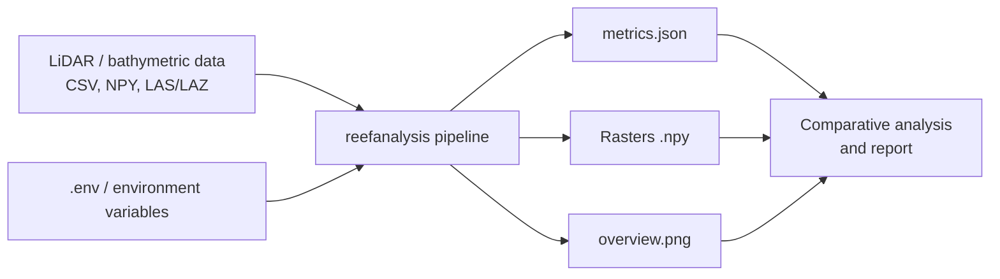
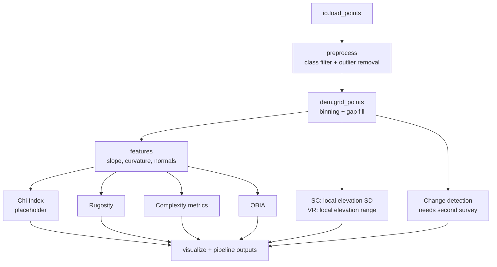
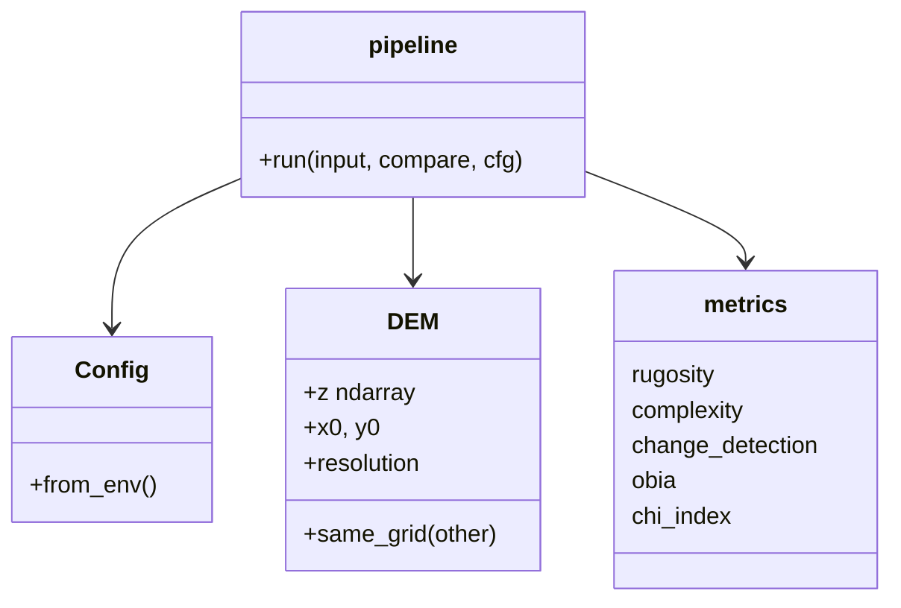

# Technical Design Document

## 1. Purpose and scope

Provide a reproducible workflow that turns LiDAR / bathymetric point clouds into reef structure metrics and lets us compare five approaches (Chi Index, rugosity, OBIA, depth change detection, structural complexity metrics) on identical inputs.

**Non-goals:** coral species classification, live data acquisition, or claiming that structural metrics measure coral "health" directly.

**Open item:** the Chi Index definition is not in this repository. It must be taken from the base paper (see [PAPER_VERIFICATION.md](PAPER_VERIFICATION.md)). The design reserves a slot for it and nothing else depends on its formula.

## 2. System context

## 3. Pipeline architecture

Mapping to the project workflow:

| Step | Module |
|---|---|
| 1 Data acquisition | `io.py`, `sample_data.py` |
| 2 Preprocessing | `preprocess.py` |
| 3 DEM generation | `dem.py` |
| 4 Feature extraction | `features.py`, `metrics/rugosity.py`, `metrics/complexity.py`, `metrics/reef_structure.py` |
| 5 Chi Index | `metrics/chi_index.py` (stub) |
| 6 Comparative analysis | `pipeline.py`, `metrics/*` |
| 7 Visualisation | `visualize.py` |

## 4. Module view

## 5. Data model

- **Point cloud:** `ndarray (N, 3|4)`: x, y, z (m) and optional ASPRS class.
- **DEM:** `z[row, col]`, row 0 = southern edge, col 0 = western edge; NaN = no data. Surveys that will be compared are gridded with **common bounds** so `same_grid` holds.
- **Results:** `metrics.json` with `complexity`, `reef_structure` (SC/VR summaries), `chi_index`, `obia`, and `change_detection`. SC/VR rasters are also written as `sc_map.npy` and `vr_map.npy`.

## 6. Method definitions as implemented

| Method | Definition |
|---|---|
| Rugosity | Sum of 3D triangle areas (two per 2×2 post block) / planimetric area. Flat = 1.0. Local version uses a NaN-aware moving mean. |
| Slope / curvature | Central-difference gradient; Laplacian curvature (negative = convex peak). |
| TRI | Mean absolute elevation difference to the 8 neighbours. |
| VRM | 1 − \|mean unit surface normal\| in a window (Sappington et al. style). |
| SC | Moving-window standard deviation of elevation, ignoring NoData; reported in elevation units (metres for this project). |
| VR | Moving-window maximum minus minimum elevation, ignoring NoData; reported in elevation units (metres for this project). |
| Fractal dimension | Area-scale method: D = 2 − slope of log(relative area) vs log(scale). |
| Change detection | DEM(t2) − DEM(t1); changes beyond the level of detection (`REEF_LOD_M`) summed as area and volume. |
| OBIA | Standardised [elevation, slope, rugosity] → KMeans → connected components per class → drop objects below `REEF_OBIA_MIN_CELLS`. Class names are heuristic. |
| Chi Index | **Not defined here. Transcribe from the base paper.** |

## 7. Configuration

All via environment variables / `.env` (table in the README), loaded once by `Config.from_env()` and passed explicitly to the pipeline; no module reads globals.

## 8. Dashboard data boundary

The dashboard combines the pipeline metrics with optional external inputs. SC and VR are calculated from the LiDAR DEM. LCC and AC must come from a benthic classification product and are accepted through an indicator JSON file as percentages. An optional external CHI score may be displayed on a 0–1 scale, clearly labelled as externally supplied; the dashboard does not recompute or validate its formula. Health-class percentages can be supplied as text or JSON and are displayed as received, with a sum check. LiDAR-derived morphology is not presented as a direct biological measurement.

## 9. Error handling

- Missing file → `FileNotFoundError`; bad columns/format → `ValueError`; LAS without `laspy` → `ImportError` with install hint.
- Mismatched DEM grids in change detection → `ValueError`.
- Chi Index not implemented → recorded as `status: not_implemented` in the results instead of aborting the run.

## 10. Testing strategy

Analytic tests (flat plane, 45° plane, zero curvature), synthetic ground truth (known gain and loss), unit tests for gridding / filtering, and an end-to-end CLI/pipeline run. A strict `xfail` test marks the Chi Index until it is implemented against a worked example from the paper.

## 11. Risks and assumptions

| Risk | Mitigation |
|---|---|
| Chi Index formula assumed incorrectly | Not implemented until verified against the paper |
| Real bathymetric LiDAR has refraction, turbidity, tide effects | Apply corrections upstream; document in the data section of the report |
| Resolution dependence of rugosity/fractal metrics | Report DEM resolution with every result; compare at fixed resolution |
| Surveys not co-registered | Require same grid; LoD threshold; align before use |
| Synthetic data overfit | Use sample data only for correctness; validate on real datasets |

## 12. Extensibility

New methods are added as a function in `metrics/` and one call in `pipeline.run`. Raster export to GeoTIFF (rasterio) is a natural next addition.

## 13. References to verify before citing

Jenness (2004) DEM surface area; Sappington et al. (2007) vector ruggedness; Riley et al. (1999) terrain ruggedness; Risk (1972) chain-and-tape rugosity; Blaschke (2010) OBIA. Confirm bibliographic details before using them in the report.
